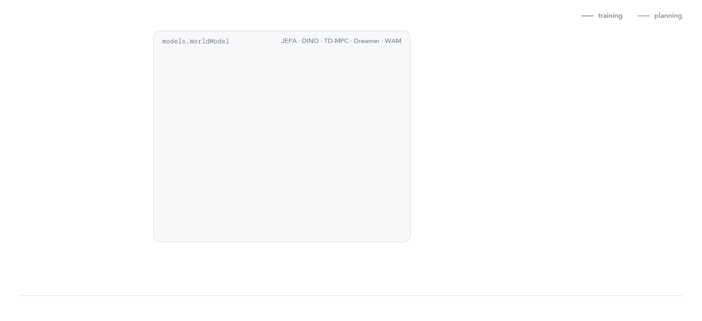

<p align="center">
  <picture>
    <source media="(prefers-color-scheme: dark)" srcset="docs/assets/banner-dark-compact.png">
    
  </picture>
</p>

<p align="center">
  <a href="https://pypi.org/project/torch-world/"></a>
  <a href="https://github.com/latent-horizon/pytorch-world/actions/workflows/ci.yml"></a>
  <a href="https://latent-horizon.github.io/pytorch-world/"></a>
  <a href="https://huggingface.co/latenthorizon"></a>
  <a href="LICENSE.md"></a>
  <a href="https://colab.research.google.com/github/latent-horizon/pytorch-world/blob/main/examples/quickstart.ipynb"></a>
</p>

A library of world models for PyTorch: shared layers, objectives, planners and environments, so a new model is a short file and models are easy to compare.

```bash
uv add torch_world
```

```python
from torch_world.envs import PointMass
from torch_world.models import LeWM
from torch_world.nn import CLSEncoder
from torch_world.planning import CEM

model = LeWM(CLSEncoder(img_size=32, patch_size=8, embed_dim=64), action_dim=2, embed_dim=64)
episodes = PointMass(batch_size=64).collect(4)
loss = model(episodes["pixels"], episodes["actions"])["loss"]

z = model.eval().encode(episodes["pixels"][:, :1])
goal = model.encode(episodes["pixels"][:, -1:])[:, 0]
actions = CEM(horizon=5, action_dim=2)(model, z, goal)
```

Full walkthrough: [quickstart notebook](examples/quickstart.ipynb).

## Models

| family | models |
|---|---|
| [JEPA](docs/models/jepa/index.md) | `IJEPA`, `VJEPA`, `LeJEPA`, `LeWM`, `PLDM`, `HWM` and [14 more](docs/models/jepa/index.md) |
| [DINO](docs/models/dino/index.md) | `DINOv2`, `DINOWM` |
| [TD-MPC](docs/models/tdmpc/index.md) | `TDMPC2` |
| [Dreamer](docs/models/dreamer/index.md) | `DreamerV3` |
| [World action models](docs/models/wam/index.md) | `DreamZero` |

## Architecture

Every model implements `encode` and `predict` on the shared `WorldModel` interface. Training learns them from data; planning reuses them to imagine rollouts and choose actions.

<p align="center">
  <picture>
    <source media="(prefers-color-scheme: dark)" srcset="docs/assets/diagrams/architecture-dark.gif">
    
  </picture>
</p>

## Links

[Documentation](https://latent-horizon.github.io/pytorch-world/) · [Benchmark results](docs/guides/results.md) · [Environments](docs/guides/benchmark-environments.md) · [Contributing](CONTRIBUTING.md) · [Governance](GOVERNANCE.md) · [Security](SECURITY.md)

## Contributors

<a href="https://github.com/latent-horizon/pytorch-world/graphs/contributors">
  
</a>

## License

[Apache 2.0](LICENSE.md). Supported by [Latent Horizon](https://github.com/latent-horizon).
