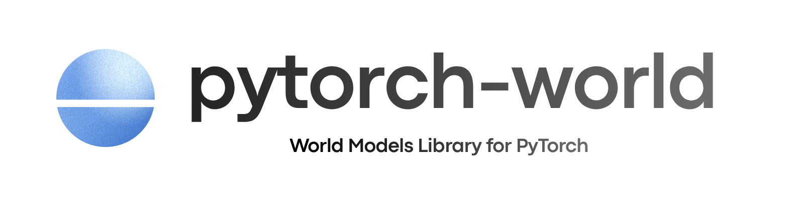

<div class="tw-hero">

{ .tw-logo--light }
{ .tw-logo--dark }

World models para PyTorch. Aprende cómo evoluciona un mundo y luego planifica imaginando lo que viene después. Las piezas compartidas mantienen cada modelo breve y fácil de comparar.

<div class="tw-install">

```bash
uv add torch_world
```

</div>

<div class="tw-actions">

[Empezar](getting-started/quickstart.md){ .tw-button .tw-button--primary }
[Modelos](models/index.md){ .tw-button }
[API](api/index.md){ .tw-button }

</div>

</div>


<div class="grid cards">

-   :material-family-tree:{ .lg } **Familias de modelos**

    ---

    Modelos agrupados según cómo aprenden: JEPA, desde el preentrenamiento con imágenes hasta el control multirrobot; DINO; TD-MPC, para control guiado por recompensas; y world action models, que imaginan vídeo y actúan. Llegarán más familias.

    [:octicons-arrow-right-24: Modelos](models/index.md)

-   :material-earth:{ .lg } **Una sola interfaz de world model**

    ---

    `encode`, `predict` y `rollout` son iguales en todos los world models, así que pueden entrenarse, compararse y usarse para planificar de forma intercambiable.

    [:octicons-arrow-right-24: Conceptos](getting-started/concepts.md)

-   :material-map-marker-path:{ .lg } **Planificación**

    ---

    Busca acciones dentro de la imaginación de un modelo. El método de entropía cruzada funciona con cualquier world model, sin código adicional.

    [:octicons-arrow-right-24: Guía de planificación](guides/planning.md)

-   :material-robot-industrial:{ .lg } **Entornos**

    ---

    190 entornos: 33 tareas integradas, desde puzles de planificación hasta manipulación con Franka, además de OGBench, DMControl, Meta-World, ManiSkill, MyoSuite, RoboCasa y RoboDojo.

    [:octicons-arrow-right-24: Entornos](environments/index.md)

-   :material-database-outline:{ .lg } **Datasets**

    ---

    Ventanas sobre experiencia recopilada para entrenar dinámicas, además de imágenes médicas y preguntas para modelos de visión y lenguaje.

    [:octicons-arrow-right-24: Datasets](datasets/index.md)

-   :material-cube-outline:{ .lg } **Componentes básicos**

    ---

    Vision transformers para imágenes y vídeo, predictores condicionados, estrategias de enmascarado y objetivos, compartidos por todas las familias.

    [:octicons-arrow-right-24: Referencia de la API](api/index.md)

</div>

## Entornos {#environments}

190 entornos: 33 integrados, 13 de OGBench, 20 de DMControl, 10 de Meta-World, 12 de ManiSkill, 10 de MyoSuite, 50 de RoboCasa y 42 de RoboDojo. Las tareas integradas muestran un episodio exitoso verificado; las tareas de OGBench reproducen un episodio de su dataset, las de Meta-World su experto programado, las de DMControl, ManiSkill y MyoSuite una política aleatoria, las de RoboCasa una demostración humana y las de RoboDojo su vídeo oficial de la tarea. Consulta [Entornos](environments/index.md) para ver cada uno.

<div class="tw-gallery">

[{ loading=lazy width="120" height="120" }<span>Arrange Bread Basket</span>](environments/index.md#robocasa)
[{ loading=lazy width="120" height="120" }<span>stack bowls</span>](environments/index.md#robodojo)
[{ loading=lazy width="120" height="120" }<span>Checkpoints</span>](examples/envs/puzzles/checkpoints_v0.ipynb)
[{ loading=lazy width="120" height="120" }<span>acrobot-swingup</span>](environments/index.md#deepmind-control-suite)
[{ loading=lazy width="120" height="120" }<span>Arrange Tea</span>](environments/index.md#robocasa)
[{ loading=lazy width="120" height="120" }<span>push T</span>](environments/index.md#robodojo)
[{ loading=lazy width="120" height="120" }<span>pointmaze-medium-navigate</span>](environments/index.md#ogbench)
[{ loading=lazy width="120" height="120" }<span>PickCube-v1</span>](environments/index.md#maniskill)
[{ loading=lazy width="120" height="120" }<span>IceMaze</span>](examples/envs/puzzles/icemaze_v0.ipynb)
[{ loading=lazy width="120" height="120" }<span>reach-v3</span>](environments/index.md#meta-world)
[{ loading=lazy width="120" height="120" }<span>myoFingerReachRandom-v0</span>](environments/index.md#myosuite)
[{ loading=lazy width="120" height="120" }<span>Bread Selection</span>](environments/index.md#robocasa)
[{ loading=lazy width="120" height="120" }<span>pack objects into box</span>](environments/index.md#robodojo)
[{ loading=lazy width="120" height="120" }<span>Categorize Condiments</span>](environments/index.md#robocasa)
[{ loading=lazy width="120" height="120" }<span>ball_in_cup-catch</span>](environments/index.md#deepmind-control-suite)
[{ loading=lazy width="120" height="120" }<span>KeyDoor</span>](examples/envs/puzzles/keydoor_v0.ipynb)
[{ loading=lazy width="120" height="120" }<span>fold clothes</span>](environments/index.md#robodojo)
[{ loading=lazy width="120" height="120" }<span>Close Blender Lid</span>](environments/index.md#robocasa)
[{ loading=lazy width="120" height="120" }<span>hang mugs</span>](environments/index.md#robodojo)
[{ loading=lazy width="120" height="120" }<span>Maze</span>](examples/envs/puzzles/maze_v0.ipynb)
[{ loading=lazy width="120" height="120" }<span>Close Fridge</span>](environments/index.md#robocasa)
[{ loading=lazy width="120" height="120" }<span>antmaze-medium-navigate</span>](environments/index.md#ogbench)
[{ loading=lazy width="120" height="120" }<span>cartpole-balance</span>](environments/index.md#deepmind-control-suite)
[{ loading=lazy width="120" height="120" }<span>PushCube-v1</span>](environments/index.md#maniskill)
[{ loading=lazy width="120" height="120" }<span>Close Toaster Oven Door</span>](environments/index.md#robocasa)
[{ loading=lazy width="120" height="120" }<span>sweep blocks</span>](environments/index.md#robodojo)
[{ loading=lazy width="120" height="120" }<span>Sokoban</span>](examples/envs/puzzles/sokoban_v0.ipynb)
[{ loading=lazy width="120" height="120" }<span>push-v3</span>](environments/index.md#meta-world)
[{ loading=lazy width="120" height="120" }<span>myoFingerPoseRandom-v0</span>](environments/index.md#myosuite)
[{ loading=lazy width="120" height="120" }<span>Coffee Setup Mug</span>](environments/index.md#robocasa)
[{ loading=lazy width="120" height="120" }<span>pour liquid into cup</span>](environments/index.md#robodojo)
[{ loading=lazy width="120" height="120" }<span>Cutting Tool Selection</span>](environments/index.md#robocasa)
[{ loading=lazy width="120" height="120" }<span>BallPlate</span>](examples/envs/control/ballplate_v0.ipynb)
[{ loading=lazy width="120" height="120" }<span>cartpole-balance_sparse</span>](environments/index.md#deepmind-control-suite)
[{ loading=lazy width="120" height="120" }<span>make toast</span>](environments/index.md#robodojo)
[{ loading=lazy width="120" height="120" }<span>Deliver Straw</span>](environments/index.md#robocasa)
[{ loading=lazy width="120" height="120" }<span>visual-antmaze-medium-navigate</span>](environments/index.md#ogbench)
[{ loading=lazy width="120" height="120" }<span>arrange largest number</span>](environments/index.md#robodojo)
[{ loading=lazy width="120" height="120" }<span>CartpoleSwingup</span>](examples/envs/control/cartpoleswingup_v0.ipynb)
[{ loading=lazy width="120" height="120" }<span>PullCube-v1</span>](environments/index.md#maniskill)
[{ loading=lazy width="120" height="120" }<span>Garnish Pancake</span>](environments/index.md#robocasa)
[{ loading=lazy width="120" height="120" }<span>cartpole-swingup</span>](environments/index.md#deepmind-control-suite)
[{ loading=lazy width="120" height="120" }<span>sort nesting dolls by size</span>](environments/index.md#robodojo)
[{ loading=lazy width="120" height="120" }<span>Gather Tableware</span>](environments/index.md#robocasa)
[{ loading=lazy width="120" height="120" }<span>ReactionWheel</span>](examples/envs/control/reactionwheel_v0.ipynb)
[{ loading=lazy width="120" height="120" }<span>pick-place-v3</span>](environments/index.md#meta-world)
[{ loading=lazy width="120" height="120" }<span>myoElbowPose1D6MRandom-v0</span>](environments/index.md#myosuite)
[{ loading=lazy width="120" height="120" }<span>Get Toasted Bread</span>](environments/index.md#robocasa)
[{ loading=lazy width="120" height="120" }<span>store laptop and headphones</span>](environments/index.md#robodojo)
[{ loading=lazy width="120" height="120" }<span>NewtonAcrobot</span>](examples/envs/control/newtonacrobot_v0.ipynb)
[{ loading=lazy width="120" height="120" }<span>humanoidmaze-medium-navigate</span>](environments/index.md#ogbench)
[{ loading=lazy width="120" height="120" }<span>Heat Kebab Sandwich</span>](environments/index.md#robocasa)
[{ loading=lazy width="120" height="120" }<span>stack blocks</span>](environments/index.md#robodojo)
[{ loading=lazy width="120" height="120" }<span>cartpole-swingup_sparse</span>](environments/index.md#deepmind-control-suite)
[{ loading=lazy width="120" height="120" }<span>Kettle Boiling</span>](environments/index.md#robocasa)
[{ loading=lazy width="120" height="120" }<span>PokeCube-v1</span>](environments/index.md#maniskill)
[{ loading=lazy width="120" height="120" }<span>NewtonPendulum</span>](examples/envs/control/newtonpendulum_v0.ipynb)
[{ loading=lazy width="120" height="120" }<span>fasten screws</span>](environments/index.md#robodojo)
[{ loading=lazy width="120" height="120" }<span>Load Dishwasher</span>](environments/index.md#robocasa)
[{ loading=lazy width="120" height="120" }<span>insert tubes</span>](environments/index.md#robodojo)

</div>

<div class="tw-more">

[Ver todos los entornos :octicons-arrow-right-24:](environments/index.md)

</div>


## Colaboradores {#contributors}

pytorch-world se construye en abierto. Gracias a todas las personas que aportan código, modelos, entornos e ideas.

<div class="tw-contributors" data-repo="latent-horizon/pytorch-world">

[Colaboradores en GitHub](https://github.com/latent-horizon/pytorch-world/graphs/contributors)

</div>

<div class="tw-more">

[Cómo contribuir :octicons-arrow-right-24:](contributing.md)

</div>


## Treinta segundos {#thirty-seconds}

```python
from torch_world.envs import PointMass
from torch_world.models import LeWM
from torch_world.nn import CLSEncoder
from torch_world.planning import CEM

model = LeWM(CLSEncoder(img_size=32, patch_size=8, embed_dim=64), action_dim=2, embed_dim=64)
episodes = PointMass(batch_size=64).collect(4)                 # pixels (64, 4, 3, 32, 32), actions (64, 4, 2)
loss = model(episodes["pixels"], episodes["actions"])["loss"]  # prediction + SIGReg

model.eval()
z, goal = model.encode(episodes["pixels"][:, :1]), model.encode(episodes["pixels"][:, -1:])[:, 0]
actions = CEM(horizon=5, action_dim=2)(model, z, goal)         # (64, 5, 2)
```

Esto entrena LeWM, un world model JEPA, sobre un point mass y planifica hacia una imagen objetivo. Lee el [inicio rápido](getting-started/quickstart.md) para saber qué hace cada línea, o abre el [notebook de introducción](examples/intro.ipynb).


## En un minuto {#in-one-minute}

<div class="tw-film">
<video src="../assets/video/pytorch-world.mp4" poster="../assets/video/pytorch-world-poster.jpg" title="pytorch-world en un minuto" preload="none" playsinline controls></video>
</div>
