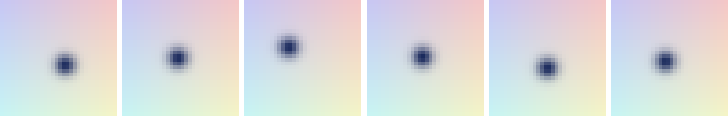
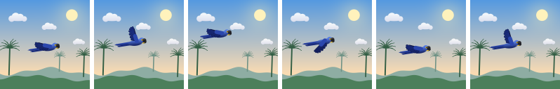
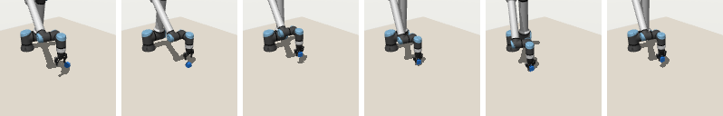
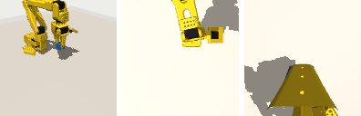

# Environments

`torch_world.envs` holds worlds to train and test world models in: two light pixel worlds that run on the GPU with nothing but PyTorch, and a MuJoCo pick-and-place task with real robot arms. All are batched (one object steps `batch_size` worlds at once) and return RGB images in `[0, 1]`.

All of them share one interface:

| member | |
|---|---|
| `reset(state=None, generator=None)` | random (or given) states; returns images `(B, 3, size, size)` |
| `step(action)` | applies `(B, action_dim)` actions in `[-1, 1]`; returns images |
| `render(state=None, ...)` | images of the current or of any states, used for goal images |
| `collect(num_steps, generator=None)` | episodes `{"pixels", "actions", "states"}`, each `(B, T, ...)` |
| `distance(states, goal)`, `success(states, goal)` | how far states are from goal states, and whether they reach them within `radius` |
| `position(states)` | the planar position to reach, for plotting paths |
| `state`, `action_dim`, `state_dim`, `radius` | |

## PointMass



A 2D point in the unit square, rendered as a dark Gaussian blob on a light gradient. Actions are velocities scaled by `max_step`. The simplest test: two degrees of freedom, and the position is all there is to see.

```python
from torch_world.envs import PointMass

env = PointMass(batch_size=64, size=32)
episodes = env.collect(16)                    # random actions
goals = env.sample_goals(distance=(0.2, 0.5))  # goal states at a given distance, inside the bounds
```

## Macaw



A Hyacinth macaw flying over the Pantanal: the dynamics of `PointMass` behind a detailed scene. Its wings beat a quarter cycle per step, so a single frame does not tell the phase but a short history does. `render(state)` without a phase draws the bird gliding, as used for goal images. Rendering is resolution-free: `Macaw(size=192)` draws the same states sharper.

```python
from torch_world.envs import Macaw

env = Macaw(batch_size=16, size=64)
```

## RobotCube



Single-cube pick-and-place with a real arm in [MuJoCo](https://mujoco.org), after [OGBench](https://arxiv.org/abs/2410.20092) `cube-single`. It needs the `action` extra:

```bash
pip install "torch-world[action]"
```

| `robot` | arm | gripper |
|---|---|---|
| `"ur10e"` | Universal Robots UR10e | Robotiq 2F-85 |
| `"so101"` | the open-source SO-101 | its own jaw |

Both come from [MuJoCo Menagerie](https://github.com/google-deepmind/mujoco_menagerie) at a pinned commit and are downloaded once into `~/.cache/torch_world/menagerie`.

Actions `(dx, dy, dz, grip)` in `[-1, 1]^4` move the gripper target by up to `max_step` meters, solved by damped least-squares inverse kinematics with the gripper pointing down, and open (`grip > 0`) or close the gripper. The state is `(gripper x, y, z, opening, cube x, y, z)` in meters.

```python
from torch_world.envs import RobotCube

env = RobotCube("ur10e", batch_size=32, size=64)
episodes = env.collect(64, noise=0.1)          # play data from a noisy scripted expert

env.reset()
target = env.sample_targets()                  # goal cube positions (B, 2)
goal_states = env.solve(target, steps=60)      # the clean expert's final states, used as goals
env.success(env.state, goal_states)            # the cube rests within one cube width of its goal
```

`collect` follows OGBench's *play* datasets: the noisy expert carries the cube to a target, then picks a new one.

### Cameras



`camera` selects the observation: `"front"` (default), `"top"`, an orthographic view of the workspace, or `"wrist"`, which rides on the gripper. `render(camera=..., size=...)` draws any of them on demand, for example for multi-view models like [RoboJEPA](../models/jepa/robojepa.md). Above, the SO-101 from each camera.

### Scoring

For the cube task, `distance` is in meters between the cube and its goal, `success` requires the cube to rest on the table within `radius` (one cube width) of its goal, and `position` is the cube's position in the unit square of the `"top"` camera.

!!! note "Speed"
    The batch is simulated sequentially on the CPU, so `RobotCube` is much slower than the pixel worlds. Collect data once and train from a [`TrajectoryDataset`](../datasets/trajectories.md).

## Running a policy

```python
from torch_world.envs import run_policy

states = run_policy(env, policy, steps=20)    # (B, steps + 1, state_dim)
```

`policy` maps a batch of observations to a batch of actions; see [Planning](planning.md). To compare policies, [`goal_reaching`](planning.md#evaluating-goal-reaching) runs them all and scores them with `distance` and `success`.
