<div class="tw-hero">


World models for PyTorch. Learn how a world evolves, then plan by imagining what comes next. Shared parts keep every model short and easy to compare.

<div class="tw-install">

```bash
uv add torch_world
```

</div>

<div class="tw-actions">

[Get started](getting-started/quickstart.md){ .tw-button .tw-button--primary }
[Models](models/index.md){ .tw-button }
[API](api/index.md){ .tw-button }

</div>

</div>


<div class="grid cards">

-   :material-family-tree:{ .lg } **Model families**

    ---

    Models grouped by how they learn: JEPA, from image pretraining to multi-robot control; DINO; TD-MPC, for reward-driven control; and world action models, which imagine video and act. More families are coming.

    [:octicons-arrow-right-24: Models](models/index.md)

-   :material-earth:{ .lg } **One world-model interface**

    ---

    `encode`, `predict` and `rollout` are the same for every world model, so they can be trained, compared and planned with interchangeably.

    [:octicons-arrow-right-24: Concepts](getting-started/concepts.md)

-   :material-map-marker-path:{ .lg } **Planning**

    ---

    Search for actions inside a model's imagination. The cross-entropy method works with any world model, with no extra code.

    [:octicons-arrow-right-24: Planning guide](guides/planning.md)

-   :material-robot-industrial:{ .lg } **Environments**

    ---

    190 environments: 33 built-in tasks from planning puzzles to Franka manipulation, plus OGBench, DMControl, Meta-World, ManiSkill, MyoSuite, RoboCasa and RoboDojo.

    [:octicons-arrow-right-24: Environments](environments/index.md)

-   :material-database-outline:{ .lg } **Datasets**

    ---

    Windows over collected experience for training dynamics, plus medical images and questions for vision-language models.

    [:octicons-arrow-right-24: Datasets](datasets/index.md)

-   :material-cube-outline:{ .lg } **Building blocks**

    ---

    Vision transformers for images and video, conditioned predictors, masking strategies and objectives, shared by every family.

    [:octicons-arrow-right-24: API reference](api/index.md)

</div>

## Environments

190 environments: 33 built-in, 13 from OGBench, 20 from DMControl, 10 from Meta-World, 12 from ManiSkill, 10 from MyoSuite, 50 from RoboCasa and 42 from RoboDojo. Built-in tasks show a verified successful episode; OGBench tasks replay an episode of their dataset, Meta-World tasks its scripted expert, DMControl, ManiSkill and MyoSuite tasks a random policy, RoboCasa tasks a human demonstration, and RoboDojo tasks its official task video. See [Environments](environments/index.md) for each one.

### Built-in

<div class="tw-carousel">

[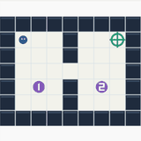{ loading=lazy width="120" height="120" }<span>Checkpoints</span>](examples/envs/puzzles/checkpoints_v0.ipynb)
[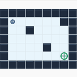{ loading=lazy width="120" height="120" }<span>IceMaze</span>](examples/envs/puzzles/icemaze_v0.ipynb)
[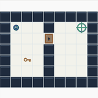{ loading=lazy width="120" height="120" }<span>KeyDoor</span>](examples/envs/puzzles/keydoor_v0.ipynb)
[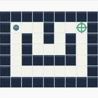{ loading=lazy width="120" height="120" }<span>Maze</span>](examples/envs/puzzles/maze_v0.ipynb)
[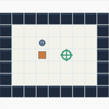{ loading=lazy width="120" height="120" }<span>Sokoban</span>](examples/envs/puzzles/sokoban_v0.ipynb)
[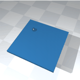{ loading=lazy width="120" height="120" }<span>BallPlate</span>](examples/envs/control/ballplate_v0.ipynb)
[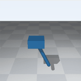{ loading=lazy width="120" height="120" }<span>CartpoleSwingup</span>](examples/envs/control/cartpoleswingup_v0.ipynb)
[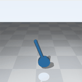{ loading=lazy width="120" height="120" }<span>ReactionWheel</span>](examples/envs/control/reactionwheel_v0.ipynb)
[{ loading=lazy width="120" height="120" }<span>NewtonAcrobot</span>](examples/envs/control/newtonacrobot_v0.ipynb)
[{ loading=lazy width="120" height="120" }<span>NewtonPendulum</span>](examples/envs/control/newtonpendulum_v0.ipynb)
[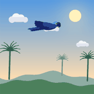{ loading=lazy width="120" height="120" }<span>Macaw</span>](examples/envs/navigation/macaw_v0.ipynb)
[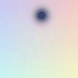{ loading=lazy width="120" height="120" }<span>PointMass</span>](examples/envs/navigation/pointmass_v0.ipynb)
[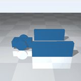{ loading=lazy width="120" height="120" }<span>DifferentialParking</span>](examples/envs/navigation/differentialparking_v0.ipynb)
[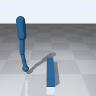{ loading=lazy width="120" height="120" }<span>HurdleHopper</span>](examples/envs/navigation/hurdlehopper_v0.ipynb)
[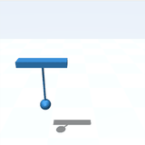{ loading=lazy width="120" height="120" }<span>PayloadTransport</span>](examples/envs/navigation/payloadtransport_v0.ipynb)
[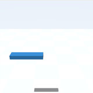{ loading=lazy width="120" height="120" }<span>PlanarQuadrotor</span>](examples/envs/navigation/planarquadrotor_v0.ipynb)
[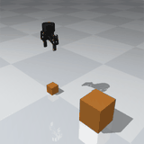{ loading=lazy width="120" height="120" }<span>BlockStack</span>](examples/envs/manipulation/blockstack_v0.ipynb)
[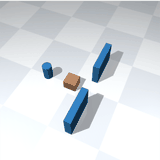{ loading=lazy width="120" height="120" }<span>BoxGate</span>](examples/envs/manipulation/boxgate_v0.ipynb)
[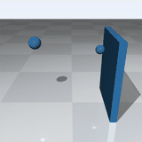{ loading=lazy width="120" height="120" }<span>DoorOpen</span>](examples/envs/manipulation/dooropen_v0.ipynb)
[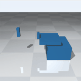{ loading=lazy width="120" height="120" }<span>DrawerOpen</span>](examples/envs/manipulation/draweropen_v0.ipynb)
[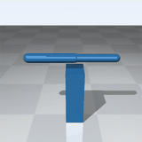{ loading=lazy width="120" height="120" }<span>ObstacleArm</span>](examples/envs/manipulation/obstaclearm_v0.ipynb)
[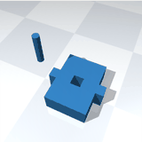{ loading=lazy width="120" height="120" }<span>PegInsertion</span>](examples/envs/manipulation/peginsertion_v0.ipynb)
[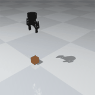{ loading=lazy width="120" height="120" }<span>PickPlace</span>](examples/envs/manipulation/pickplace_v0.ipynb)
[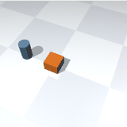{ loading=lazy width="120" height="120" }<span>PuckPush</span>](examples/envs/manipulation/puckpush_v0.ipynb)
[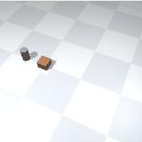{ loading=lazy width="120" height="120" }<span>PuckSlide</span>](examples/envs/manipulation/puckslide_v0.ipynb)
[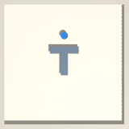{ loading=lazy width="120" height="120" }<span>PushT</span>](examples/envs/manipulation/pusht_v0.ipynb)
[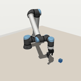{ loading=lazy width="120" height="120" }<span>RobotCube</span>](examples/envs/manipulation/robotcube_v0.ipynb)
[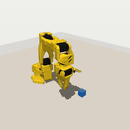{ loading=lazy width="120" height="120" }<span>RobotCubeSO101</span>](examples/envs/manipulation/robotcubeso101_v0.ipynb)
[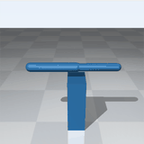{ loading=lazy width="120" height="120" }<span>SpatialArm</span>](examples/envs/manipulation/spatialarm_v0.ipynb)
[{ loading=lazy width="120" height="120" }<span>FrankaCubeLift</span>](examples/envs/manipulation/frankacubelift_v0.ipynb)
[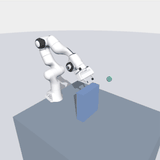{ loading=lazy width="120" height="120" }<span>FrankaObstacleReach</span>](examples/envs/manipulation/frankaobstaclereach_v0.ipynb)
[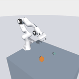{ loading=lazy width="120" height="120" }<span>FrankaTablePush</span>](examples/envs/manipulation/frankatablepush_v0.ipynb)

</div>

### OGBench

<div class="tw-carousel">

[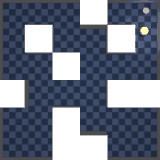{ loading=lazy width="120" height="120" }<span>pointmaze-medium-navigate</span>](environments/index.md#ogbench)
[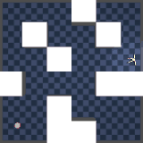{ loading=lazy width="120" height="120" }<span>antmaze-medium-navigate</span>](environments/index.md#ogbench)
[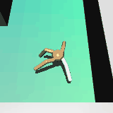{ loading=lazy width="120" height="120" }<span>visual-antmaze-medium-navigate</span>](environments/index.md#ogbench)
[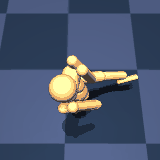{ loading=lazy width="120" height="120" }<span>humanoidmaze-medium-navigate</span>](environments/index.md#ogbench)
[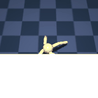{ loading=lazy width="120" height="120" }<span>antsoccer-arena-navigate</span>](environments/index.md#ogbench)
[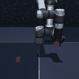{ loading=lazy width="120" height="120" }<span>cube-single-play</span>](environments/index.md#ogbench)
[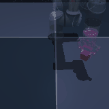{ loading=lazy width="120" height="120" }<span>visual-cube-single-play</span>](environments/index.md#ogbench)
[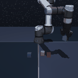{ loading=lazy width="120" height="120" }<span>cube-double-play</span>](environments/index.md#ogbench)
[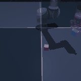{ loading=lazy width="120" height="120" }<span>visual-cube-double-play</span>](environments/index.md#ogbench)
[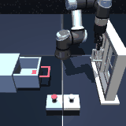{ loading=lazy width="120" height="120" }<span>scene-play</span>](environments/index.md#ogbench)
[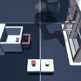{ loading=lazy width="120" height="120" }<span>visual-scene-play</span>](environments/index.md#ogbench)
[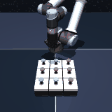{ loading=lazy width="120" height="120" }<span>puzzle-3x3-play</span>](environments/index.md#ogbench)
[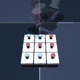{ loading=lazy width="120" height="120" }<span>visual-puzzle-3x3-play</span>](environments/index.md#ogbench)

</div>

### DeepMind Control Suite

<div class="tw-carousel">

[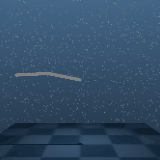{ loading=lazy width="120" height="120" }<span>acrobot-swingup</span>](environments/index.md#deepmind-control-suite)
[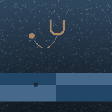{ loading=lazy width="120" height="120" }<span>ball_in_cup-catch</span>](environments/index.md#deepmind-control-suite)
[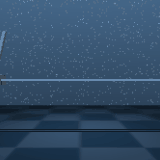{ loading=lazy width="120" height="120" }<span>cartpole-balance</span>](environments/index.md#deepmind-control-suite)
[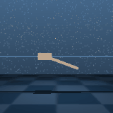{ loading=lazy width="120" height="120" }<span>cartpole-balance_sparse</span>](environments/index.md#deepmind-control-suite)
[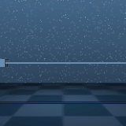{ loading=lazy width="120" height="120" }<span>cartpole-swingup</span>](environments/index.md#deepmind-control-suite)
[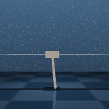{ loading=lazy width="120" height="120" }<span>cartpole-swingup_sparse</span>](environments/index.md#deepmind-control-suite)
[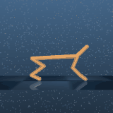{ loading=lazy width="120" height="120" }<span>cheetah-run</span>](environments/index.md#deepmind-control-suite)
[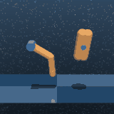{ loading=lazy width="120" height="120" }<span>finger-spin</span>](environments/index.md#deepmind-control-suite)
[{ loading=lazy width="120" height="120" }<span>finger-turn_easy</span>](environments/index.md#deepmind-control-suite)
[{ loading=lazy width="120" height="120" }<span>finger-turn_hard</span>](environments/index.md#deepmind-control-suite)
[{ loading=lazy width="120" height="120" }<span>hopper-hop</span>](environments/index.md#deepmind-control-suite)
[{ loading=lazy width="120" height="120" }<span>hopper-stand</span>](environments/index.md#deepmind-control-suite)
[{ loading=lazy width="120" height="120" }<span>pendulum-swingup</span>](environments/index.md#deepmind-control-suite)
[{ loading=lazy width="120" height="120" }<span>quadruped-run</span>](environments/index.md#deepmind-control-suite)
[{ loading=lazy width="120" height="120" }<span>quadruped-walk</span>](environments/index.md#deepmind-control-suite)
[{ loading=lazy width="120" height="120" }<span>reacher-easy</span>](environments/index.md#deepmind-control-suite)
[{ loading=lazy width="120" height="120" }<span>reacher-hard</span>](environments/index.md#deepmind-control-suite)
[{ loading=lazy width="120" height="120" }<span>walker-run</span>](environments/index.md#deepmind-control-suite)
[{ loading=lazy width="120" height="120" }<span>walker-stand</span>](environments/index.md#deepmind-control-suite)
[{ loading=lazy width="120" height="120" }<span>walker-walk</span>](environments/index.md#deepmind-control-suite)

</div>

### Meta-World

<div class="tw-carousel">

[{ loading=lazy width="120" height="120" }<span>reach-v3</span>](environments/index.md#meta-world)
[{ loading=lazy width="120" height="120" }<span>push-v3</span>](environments/index.md#meta-world)
[{ loading=lazy width="120" height="120" }<span>pick-place-v3</span>](environments/index.md#meta-world)
[{ loading=lazy width="120" height="120" }<span>door-open-v3</span>](environments/index.md#meta-world)
[{ loading=lazy width="120" height="120" }<span>drawer-open-v3</span>](environments/index.md#meta-world)
[{ loading=lazy width="120" height="120" }<span>drawer-close-v3</span>](environments/index.md#meta-world)
[{ loading=lazy width="120" height="120" }<span>button-press-topdown-v3</span>](environments/index.md#meta-world)
[{ loading=lazy width="120" height="120" }<span>peg-insert-side-v3</span>](environments/index.md#meta-world)
[{ loading=lazy width="120" height="120" }<span>window-open-v3</span>](environments/index.md#meta-world)
[{ loading=lazy width="120" height="120" }<span>window-close-v3</span>](environments/index.md#meta-world)

</div>

### ManiSkill

<div class="tw-carousel">

[{ loading=lazy width="120" height="120" }<span>PickCube-v1</span>](environments/index.md#maniskill)
[{ loading=lazy width="120" height="120" }<span>PushCube-v1</span>](environments/index.md#maniskill)
[{ loading=lazy width="120" height="120" }<span>PullCube-v1</span>](environments/index.md#maniskill)
[{ loading=lazy width="120" height="120" }<span>PokeCube-v1</span>](environments/index.md#maniskill)
[{ loading=lazy width="120" height="120" }<span>StackCube-v1</span>](environments/index.md#maniskill)
[{ loading=lazy width="120" height="120" }<span>PlaceSphere-v1</span>](environments/index.md#maniskill)
[{ loading=lazy width="120" height="120" }<span>RollBall-v1</span>](environments/index.md#maniskill)
[{ loading=lazy width="120" height="120" }<span>LiftPegUpright-v1</span>](environments/index.md#maniskill)
[{ loading=lazy width="120" height="120" }<span>PullCubeTool-v1</span>](environments/index.md#maniskill)
[{ loading=lazy width="120" height="120" }<span>PushT-v1</span>](environments/index.md#maniskill)
[{ loading=lazy width="120" height="120" }<span>PegInsertionSide-v1</span>](environments/index.md#maniskill)
[{ loading=lazy width="120" height="120" }<span>PlugCharger-v1</span>](environments/index.md#maniskill)

</div>

### MyoSuite

<div class="tw-carousel">

[{ loading=lazy width="120" height="120" }<span>myoFingerReachRandom-v0</span>](environments/index.md#myosuite)
[{ loading=lazy width="120" height="120" }<span>myoFingerPoseRandom-v0</span>](environments/index.md#myosuite)
[{ loading=lazy width="120" height="120" }<span>myoElbowPose1D6MRandom-v0</span>](environments/index.md#myosuite)
[{ loading=lazy width="120" height="120" }<span>myoHandReachRandom-v0</span>](environments/index.md#myosuite)
[{ loading=lazy width="120" height="120" }<span>myoHandPoseRandom-v0</span>](environments/index.md#myosuite)
[{ loading=lazy width="120" height="120" }<span>myoHandKeyTurnRandom-v0</span>](environments/index.md#myosuite)
[{ loading=lazy width="120" height="120" }<span>myoHandObjHoldRandom-v0</span>](environments/index.md#myosuite)
[{ loading=lazy width="120" height="120" }<span>myoHandPenTwirlRandom-v0</span>](environments/index.md#myosuite)
[{ loading=lazy width="120" height="120" }<span>myoHandReorient8-v0</span>](environments/index.md#myosuite)
[{ loading=lazy width="120" height="120" }<span>myoLegWalk-v0</span>](environments/index.md#myosuite)

</div>

### RoboCasa

<div class="tw-carousel">

[{ loading=lazy width="120" height="120" }<span>Arrange Bread Basket</span>](environments/index.md#robocasa)
[{ loading=lazy width="120" height="120" }<span>Arrange Tea</span>](environments/index.md#robocasa)
[{ loading=lazy width="120" height="120" }<span>Bread Selection</span>](environments/index.md#robocasa)
[{ loading=lazy width="120" height="120" }<span>Categorize Condiments</span>](environments/index.md#robocasa)
[{ loading=lazy width="120" height="120" }<span>Close Blender Lid</span>](environments/index.md#robocasa)
[{ loading=lazy width="120" height="120" }<span>Close Fridge</span>](environments/index.md#robocasa)
[{ loading=lazy width="120" height="120" }<span>Close Toaster Oven Door</span>](environments/index.md#robocasa)
[{ loading=lazy width="120" height="120" }<span>Coffee Setup Mug</span>](environments/index.md#robocasa)
[{ loading=lazy width="120" height="120" }<span>Cutting Tool Selection</span>](environments/index.md#robocasa)
[{ loading=lazy width="120" height="120" }<span>Deliver Straw</span>](environments/index.md#robocasa)
[{ loading=lazy width="120" height="120" }<span>Garnish Pancake</span>](environments/index.md#robocasa)
[{ loading=lazy width="120" height="120" }<span>Gather Tableware</span>](environments/index.md#robocasa)
[{ loading=lazy width="120" height="120" }<span>Get Toasted Bread</span>](environments/index.md#robocasa)
[{ loading=lazy width="120" height="120" }<span>Heat Kebab Sandwich</span>](environments/index.md#robocasa)
[{ loading=lazy width="120" height="120" }<span>Kettle Boiling</span>](environments/index.md#robocasa)
[{ loading=lazy width="120" height="120" }<span>Load Dishwasher</span>](environments/index.md#robocasa)
[{ loading=lazy width="120" height="120" }<span>Make Ice Lemonade</span>](environments/index.md#robocasa)
[{ loading=lazy width="120" height="120" }<span>Navigate Kitchen</span>](environments/index.md#robocasa)
[{ loading=lazy width="120" height="120" }<span>Open Cabinet</span>](environments/index.md#robocasa)
[{ loading=lazy width="120" height="120" }<span>Open Drawer</span>](environments/index.md#robocasa)
[{ loading=lazy width="120" height="120" }<span>Open Stand Mixer Head</span>](environments/index.md#robocasa)
[{ loading=lazy width="120" height="120" }<span>Pack Identical Lunches</span>](environments/index.md#robocasa)
[{ loading=lazy width="120" height="120" }<span>Pan Transfer</span>](environments/index.md#robocasa)
[{ loading=lazy width="120" height="120" }<span>Pick Place Counter To Cabinet</span>](environments/index.md#robocasa)
[{ loading=lazy width="120" height="120" }<span>Pick Place Counter To Stove</span>](environments/index.md#robocasa)
[{ loading=lazy width="120" height="120" }<span>Pick Place Drawer To Counter</span>](environments/index.md#robocasa)
[{ loading=lazy width="120" height="120" }<span>Pick Place Sink To Counter</span>](environments/index.md#robocasa)
[{ loading=lazy width="120" height="120" }<span>Pick Place Toaster To Counter</span>](environments/index.md#robocasa)
[{ loading=lazy width="120" height="120" }<span>Portion Hot Dogs</span>](environments/index.md#robocasa)
[{ loading=lazy width="120" height="120" }<span>Pre Soak Pan</span>](environments/index.md#robocasa)
[{ loading=lazy width="120" height="120" }<span>Prepare Coffee</span>](environments/index.md#robocasa)
[{ loading=lazy width="120" height="120" }<span>Recycle Bottles By Type</span>](environments/index.md#robocasa)
[{ loading=lazy width="120" height="120" }<span>Rinse Sink Basin</span>](environments/index.md#robocasa)
[{ loading=lazy width="120" height="120" }<span>Scrub Cutting Board</span>](environments/index.md#robocasa)
[{ loading=lazy width="120" height="120" }<span>Searing Meat</span>](environments/index.md#robocasa)
[{ loading=lazy width="120" height="120" }<span>Separate Freezer Rack</span>](environments/index.md#robocasa)
[{ loading=lazy width="120" height="120" }<span>Set Up Cutting Station</span>](environments/index.md#robocasa)
[{ loading=lazy width="120" height="120" }<span>Slide Dishwasher Rack</span>](environments/index.md#robocasa)
[{ loading=lazy width="120" height="120" }<span>Stack Bowls Cabinet</span>](environments/index.md#robocasa)
[{ loading=lazy width="120" height="120" }<span>Steam In Microwave</span>](environments/index.md#robocasa)
[{ loading=lazy width="120" height="120" }<span>Stir Vegetables</span>](environments/index.md#robocasa)
[{ loading=lazy width="120" height="120" }<span>Store Leftovers In Bowl</span>](environments/index.md#robocasa)
[{ loading=lazy width="120" height="120" }<span>Turn Off Stove</span>](environments/index.md#robocasa)
[{ loading=lazy width="120" height="120" }<span>Turn On Electric Kettle</span>](environments/index.md#robocasa)
[{ loading=lazy width="120" height="120" }<span>Turn On Microwave</span>](environments/index.md#robocasa)
[{ loading=lazy width="120" height="120" }<span>Turn On Sink Faucet</span>](environments/index.md#robocasa)
[{ loading=lazy width="120" height="120" }<span>Waffle Reheat</span>](environments/index.md#robocasa)
[{ loading=lazy width="120" height="120" }<span>Wash Fruit Colander</span>](environments/index.md#robocasa)
[{ loading=lazy width="120" height="120" }<span>Wash Lettuce</span>](environments/index.md#robocasa)
[{ loading=lazy width="120" height="120" }<span>Weigh Ingredients</span>](environments/index.md#robocasa)

</div>

### RoboDojo

<div class="tw-carousel">

[{ loading=lazy width="120" height="120" }<span>stack bowls</span>](environments/index.md#robodojo)
[{ loading=lazy width="120" height="120" }<span>push T</span>](environments/index.md#robodojo)
[{ loading=lazy width="120" height="120" }<span>pack objects into box</span>](environments/index.md#robodojo)
[{ loading=lazy width="120" height="120" }<span>fold clothes</span>](environments/index.md#robodojo)
[{ loading=lazy width="120" height="120" }<span>hang mugs</span>](environments/index.md#robodojo)
[{ loading=lazy width="120" height="120" }<span>sweep blocks</span>](environments/index.md#robodojo)
[{ loading=lazy width="120" height="120" }<span>pour liquid into cup</span>](environments/index.md#robodojo)
[{ loading=lazy width="120" height="120" }<span>make toast</span>](environments/index.md#robodojo)
[{ loading=lazy width="120" height="120" }<span>arrange largest number</span>](environments/index.md#robodojo)
[{ loading=lazy width="120" height="120" }<span>sort nesting dolls by size</span>](environments/index.md#robodojo)
[{ loading=lazy width="120" height="120" }<span>store laptop and headphones</span>](environments/index.md#robodojo)
[{ loading=lazy width="120" height="120" }<span>stack blocks</span>](environments/index.md#robodojo)
[{ loading=lazy width="120" height="120" }<span>fasten screws</span>](environments/index.md#robodojo)
[{ loading=lazy width="120" height="120" }<span>insert tubes</span>](environments/index.md#robodojo)
[{ loading=lazy width="120" height="120" }<span>plug in charger</span>](environments/index.md#robodojo)
[{ loading=lazy width="120" height="120" }<span>pour balls into vase</span>](environments/index.md#robodojo)
[{ loading=lazy width="120" height="120" }<span>play Xylophone</span>](environments/index.md#robodojo)
[{ loading=lazy width="120" height="120" }<span>deposit coin</span>](environments/index.md#robodojo)
[{ loading=lazy width="120" height="120" }<span>insert key</span>](environments/index.md#robodojo)
[{ loading=lazy width="120" height="120" }<span>build tower</span>](environments/index.md#robodojo)
[{ loading=lazy width="120" height="120" }<span>put bottles into dustbin</span>](environments/index.md#robodojo)
[{ loading=lazy width="120" height="120" }<span>play tic tac toe</span>](environments/index.md#robodojo)
[{ loading=lazy width="120" height="120" }<span>classify objects</span>](environments/index.md#robodojo)
[{ loading=lazy width="120" height="120" }<span>fill pen holder</span>](environments/index.md#robodojo)
[{ loading=lazy width="120" height="120" }<span>fill egg holder</span>](environments/index.md#robodojo)
[{ loading=lazy width="120" height="120" }<span>organize table</span>](environments/index.md#robodojo)
[{ loading=lazy width="120" height="120" }<span>play stacking toy</span>](environments/index.md#robodojo)
[{ loading=lazy width="120" height="120" }<span>make kong</span>](environments/index.md#robodojo)
[{ loading=lazy width="120" height="120" }<span>cover blocks</span>](environments/index.md#robodojo)
[{ loading=lazy width="120" height="120" }<span>match and pick from conveyor</span>](environments/index.md#robodojo)
[{ loading=lazy width="120" height="120" }<span>swap T</span>](environments/index.md#robodojo)
[{ loading=lazy width="120" height="120" }<span>press by number</span>](environments/index.md#robodojo)
[{ loading=lazy width="120" height="120" }<span>imitate sorting sequence</span>](environments/index.md#robodojo)
[{ loading=lazy width="120" height="120" }<span>swap blocks</span>](environments/index.md#robodojo)
[{ loading=lazy width="120" height="120" }<span>align blocks</span>](environments/index.md#robodojo)
[{ loading=lazy width="120" height="120" }<span>solve equation</span>](environments/index.md#robodojo)
[{ loading=lazy width="120" height="120" }<span>stack blocks by language</span>](environments/index.md#robodojo)
[{ loading=lazy width="120" height="120" }<span>general pickup</span>](environments/index.md#robodojo)
[{ loading=lazy width="120" height="120" }<span>classify objects by language</span>](environments/index.md#robodojo)
[{ loading=lazy width="120" height="120" }<span>pick from conveyor by image</span>](environments/index.md#robodojo)
[{ loading=lazy width="120" height="120" }<span>store tools in toolbox</span>](environments/index.md#robodojo)
[{ loading=lazy width="120" height="120" }<span>pour by language</span>](environments/index.md#robodojo)

</div>


## Thirty seconds

```python
from torch_world.envs import PointMass
from torch_world.models import LeWM
from torch_world.nn import CLSEncoder
from torch_world.planning import CEM

model = LeWM(CLSEncoder(img_size=32, patch_size=8, embed_dim=64), action_dim=2, embed_dim=64)
episodes = PointMass(batch_size=64).collect(4)                 # pixels (64, 4, 3, 32, 32), actions (64, 4, 2)
loss = model(episodes["pixels"], episodes["actions"])["loss"]  # prediction + SIGReg

model.eval()
z, goal = model.encode(episodes["pixels"][:, :1]), model.encode(episodes["pixels"][:, -1:])[:, 0]
actions = CEM(horizon=5, action_dim=2)(model, z, goal)         # (64, 5, 2)
```

This trains LeWM, a JEPA world model, on a point mass and plans toward a goal image. Read the [quick start](getting-started/quickstart.md) for what each line does, or open the [tour notebook](examples/intro.ipynb).
