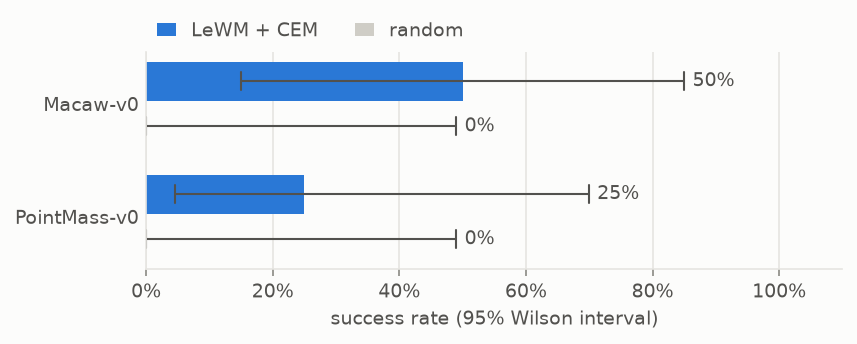
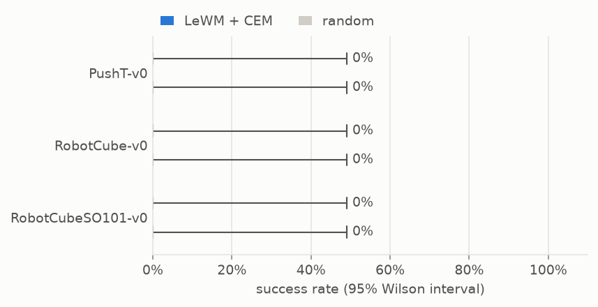

# Original environment results

All five notebooks were executed using the direct `PointMass`, `Macaw`, `PushT`, and `RobotCube` classes. The SO-101 uses `RobotCube(robot="so101")`. Hardware: NVIDIA GB10 on sparks; MuJoCo 3.15.0.

LeWM and CEM are imported from the library and can be replaced through their factories. Each notebook uses 2,048 requested training pairs, 400 updates, four evaluation seeds and a 60-step evaluation budget. Inputs are 128-pixel RGB; high-quality presentation is 512 pixels. These are small validation runs, not tuned benchmark scores.

[Policy rows (CSV)](records/benchmarks/20261017_named_worlds/summary.csv) · [Execution record](records/benchmarks/20261017_named_worlds/execution.json) · [Notebook index](README.md)

GT remains fixed across training and evaluation. PointMass, Macaw and RobotCube use seeded random starts. PushT uses one symmetric translation task, not the full random-pose distribution. RobotCube success requires release and tool withdrawal. Training uses random actions; the original play-data collectors remain available separately. Macaw's single-frame model cannot directly observe its wing phase.

Scores report final-state success; compare returns within each environment. Charts show 95% Wilson intervals over four episodes; the first seed is visualized. Earlier campaigns are preserved separately and are not pooled into these results.

## PyTorch environments

Model observations: pixels.

| Environment | Model + planner | Quality | Model success | Random success | Model return | Random return | Episode / GT |
|---|---|---|---:|---:|---:|---:|---|
| [Macaw-v0](32_macaw_v0.ipynb) | LeWM + CEM | high | 50% | 0% | -14.513 | -22.516 | [GIF + GT](records/benchmarks/20261017_named_worlds/Macaw-v0/LeWM/20261017T015610904793Z-b262245f/LeWM_CEM.gif) |
| [PointMass-v0](33_pointmass_v0.ipynb) | LeWM + CEM | high | 25% | 0% | -22.356 | -28.151 | [GIF + GT](records/benchmarks/20261017_named_worlds/PointMass-v0/LeWM/20261017T015741605245Z-9cbfac98/LeWM_CEM.gif) |



## MuJoCo manipulation and control

Model observations: pixels.

| Environment | Model + planner | Quality | Model success | Random success | Model return | Random return | Episode / GT |
|---|---|---|---:|---:|---:|---:|---|
| [PushT-v0](29_pusht_v0.ipynb) | LeWM + CEM | high | 0% | 0% | -9.593 | -9.732 | [GIF + GT](records/benchmarks/20261017_named_worlds/PushT-v0/LeWM/20261017T014731183985Z-c05b887d/LeWM_CEM.gif) |
| [RobotCube-v0](30_robotcube_v0.ipynb) | LeWM + CEM | high | 0% | 0% | -14.247 | -14.309 | [GIF + GT](records/benchmarks/20261017_named_worlds/RobotCube-v0/LeWM/20261017T014919818355Z-73e51420/LeWM_CEM.gif) |
| [RobotCubeSO101-v0](31_robotcubeso101_v0.ipynb) | LeWM + CEM | high | 0% | 0% | -5.436 | -5.489 | [GIF + GT](records/benchmarks/20261017_named_worlds/RobotCubeSO101-v0/LeWM/20261017T015111247101Z-13b6ad28/LeWM_CEM.gif) |



## Verified reference episodes

These GIFs are exported directly from the freshly executed notebooks, with checksums and provenance beside each file. Each uses seed 7 and actual actions checked against the success criterion. They are separate from LeWM/CEM evaluation and keep GT visible throughout.

| Environment | Steps | Success episode |
|---|---:|---|
| PushT-v0 | 28 | [GIF + GT](records/benchmarks/20261017_named_worlds/references/PushT-v0/episode.gif) |
| RobotCube-v0 | 24 | [GIF + GT](records/benchmarks/20261017_named_worlds/references/RobotCube-v0/episode.gif) |
| RobotCubeSO101-v0 | 79 | [GIF + GT](records/benchmarks/20261017_named_worlds/references/RobotCubeSO101-v0/episode.gif) |
| Macaw-v0 | 4 | [GIF + GT](records/benchmarks/20261017_named_worlds/references/Macaw-v0/episode.gif) |
| PointMass-v0 | 4 | [GIF + GT](records/benchmarks/20261017_named_worlds/references/PointMass-v0/episode.gif) |

## Reproduce

```bash
python examples/envs/run_notebooks.py --environments PointMass-v0 Macaw-v0 PushT-v0 RobotCube-v0 RobotCubeSO101-v0 --output-dir runs/benchmarks/my-original-envs
python examples/envs/report_results.py examples/envs/runs/benchmarks/my-original-envs --output examples/envs/LEGACY_RESULTS.md
```

Every experiment records resolved constructor settings, quality, camera, seeds, model/planner configuration, library source hash, and artifact checksums. Original class collection APIs are preserved; the shared runner uses aligned benchmark transitions from the same simulator instance.
